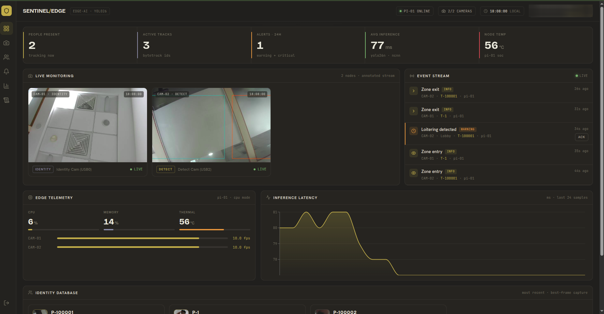
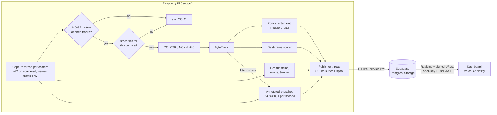

# Watchpost

Person detection and tracking on a Raspberry Pi 5 with up to three cameras, publishing events and
best-frame photos to Supabase for a web dashboard you can open from anywhere.



*The Command page of a live deployment with two USB cameras. The screenshot was taken before the
project was renamed, so the header still reads SENTINEL/EDGE.*

## How it works

There are three parts. The Pi (`edge/`) does all of the vision work. Supabase (`cloud/`) holds the
data: Postgres, Auth, Realtime and Storage. The dashboard (`dashboard/`) is a static React app on
Vercel or Netlify.

The dashboard never connects to the Pi. A site on Vercel cannot open a socket to a board behind a
home router, so the Pi pushes rows and images up to Supabase over HTTPS and the browser reads them
back down through Realtime and signed URLs. Neither side needs to know the other's address, and a
second Pi can join by using a different `node_id`.



Running YOLO on every frame of three cameras would pin a Pi 5's CPU, so the engine avoids it:

- A MOG2 background subtractor on a 320x180 copy of each frame decides whether anything moved.
  An empty scene skips YOLO entirely. Cameras with open tracks keep detecting, so a person who
  stands still and fades into the background model does not get a false exit.
- YOLO26n (NMS-free, exported to NCNN) runs on every 5th frame per camera (`schedule.stride`).
  Cameras get different offsets inside the stride, and at most one camera runs YOLO in a single
  pass of the loop, so the load stays flat.
- ByteTrack (from `supervision`) links detections across YOLO ticks into stable `track_id`s.
  Between ticks the last boxes are reused for the snapshot overlay.
- The zone engine uses the bottom-centre of each box (roughly the feet) against normalized
  polygons. Every `enter` has a matching `exit`; the last exit of a track carries `meta.final=true`.
- The best-frame scorer rates each crop by Laplacian sharpness, box size and how centred it is.
  A crop replaces the uploaded one only if it scores 15% higher, with a 3 s cooldown, so each person
  gets one good photo instead of a stream of them.
- Camera health marks a camera offline after 5 s without frames, and raises `tamper` on a
  blackout or a sudden scene change that lasts longer than 2 s.
- The vision loop only enqueues. A background thread does the network calls. Rows and best-frames
  that fail are kept in `buffer.db` and `spool/` and retried in order when the network comes back.
  Snapshots are not buffered; a newer one replaces an unsent one.

Telemetry (CPU, memory, temperature, inference latency, FPS per camera) goes to its own
`telemetry` table every 5 s and is pruned to 24 hours.

## Hardware

The setup this was built on:

| Part | Notes |
| --- | --- |
| Raspberry Pi 5 | 64-bit Raspberry Pi OS (Bookworm). Use the official 27 W supply. |
| microSD, 32 GB or more | |
| Logitech MX Brio 4K (USB) | `cam-01`, identity role. Health and snapshots only by default (`detect: false`). |
| Arducam AR0234 2.3 MP global shutter (USB) | `cam-02`, main detection camera. |
| IMX678 8 MP Starvis 2 (USB) | `cam-03`, perimeter and low light. |

Any UVC webcam works with `backend: v4l2`. CSI ribbon cameras on the Pi 5 (Camera Module 3,
Arducam CSI boards) work with `backend: picamera2`. You can mix both. Spread USB cameras across the
two USB 3.0 ports; the step-by-step setup, including CSI, is in
[docs/hardware-setup.md](docs/hardware-setup.md).

No accelerator is needed. A Hailo AI HAT+ is on the roadmap.

## Quick start

### 1. Supabase

1. Create a project at supabase.com. From Settings > API, note the project URL, the anon key and
   the service_role key.
2. New project: paste [cloud/schema.sql](cloud/schema.sql) into the SQL editor and run it.
   Existing v1 project: run [cloud/migrations/002_watchpost.sql](cloud/migrations/002_watchpost.sql)
   instead and read [docs/upgrading.md](docs/upgrading.md) first, because the rollout order matters.
3. Run [cloud/tests/rls_checks.sql](cloud/tests/rls_checks.sql) in the SQL editor. The last notice
   should read `rls_checks: all passed`. It runs in a transaction and rolls back.
4. Optional: [cloud/seed.sql](cloud/seed.sql) adds demo cameras, people and events so the
   dashboard has something to show before the Pi is running.

The schema creates both storage buckets (private) and adds `events`, `people`, `cameras` and
`telemetry` to the Realtime publication. Make sure the Email auth provider is enabled.

### 2. Raspberry Pi

```bash
git clone <this repo> ~/watchpost
cd ~/watchpost
bash edge/deploy/install.sh
```

`install.sh` installs `python3-picamera2` and `v4l-utils` from apt, creates `edge/.venv` with
`--system-site-packages` (picamera2 is apt-only), installs `edge/requirements.txt`, copies
`.env.example` to `.env`, exports `yolo26n_ncnn_model/`, and installs a systemd unit. It does not
start the service.

To do it by hand instead:

```bash
cd edge
python3 -m venv --system-site-packages .venv
.venv/bin/pip install -r requirements.txt
cp .env.example .env && chmod 600 .env
.venv/bin/yolo export model=yolo26n.pt format=ncnn imgsz=640
```

Then:

1. Put `SUPABASE_URL` and `SUPABASE_SERVICE_KEY` in `edge/.env`.
2. Edit `edge/config.yaml`: set `node_id`, and for each camera the `backend` and `device`
   (`v4l2-ctl --list-devices` for USB, `rpicam-hello --list-cameras` for CSI). Draw zones as
   polygons in 0..1 coordinates.
3. Check the cameras: `.venv/bin/python tools/camera_test.py` (live windows) or add `--save` over
   SSH to write one JPEG per camera to `edge/captures/`.
4. Dry run, which logs what would be sent and touches nothing in Supabase:
   `.venv/bin/python -m watchpost --dry-run` (add `--show` for a debug window per camera).
5. Run it for real: `.venv/bin/python -m watchpost`, or
   `sudo systemctl start watchpost && journalctl -u watchpost -f`.

If NCNN export fails with `Illegal instruction`, you are probably on a Pi 4 (16K page size). Export
on a laptop or in the `ultralytics/ultralytics:latest-arm64` Docker image and copy the folder over.
If YOLO26 gives trouble, export `yolo11n.pt` and point `model.path` at `yolo11n_ncnn_model`.

### 3. Dashboard

```bash
cd dashboard
npm install
cp .env.example .env.local    # VITE_SUPABASE_URL and VITE_SUPABASE_ANON_KEY
npm run dev                   # http://localhost:5173
```

The first account to sign up becomes admin. Later accounts are viewers until an admin changes them
on the Users page.

To deploy on Vercel, import the repo, set the root directory to `dashboard/`, pick the Vite preset
and add the two env vars. On Netlify, set the base directory to `dashboard/` and add the same env
vars; `netlify.toml` covers the rest. Both configs set a Content-Security-Policy that allows
`*.supabase.co`; a custom Supabase domain has to be added there. More in
[dashboard/README.md](dashboard/README.md). The browser only ever gets the anon key.

## Configuration

`edge/config.yaml` is commented. The keys you are most likely to touch:

| Key | Default | What it does |
| --- | --- | --- |
| `node_id` | `pi-01` | Unique per Pi. Prefix of every `person_id` and storage path. |
| `model.path` | `yolo26n_ncnn_model` | NCNN model folder, relative to `edge/`. |
| `model.conf` | `0.4` | Detection confidence threshold. |
| `schedule.stride` | `5` | YOLO on every Nth frame per camera. A camera can override it with `stride`. |
| `schedule.motion_min_area_frac` | `0.004` | Share of the frame that must change to count as motion. |
| `schedule.stagger` | `true` | Offset cameras inside the stride. |
| `tracking.exit_after_s` | `3.0` | No detection for this long ends a track. |
| `bestframe.min_gain` | `0.15` | How much better a crop must score to be uploaded again. |
| `snapshot.interval_s` | `1.0` | Annotated snapshot upload interval per camera. |
| `health.offline_after_s` | `5.0` | No frames for this long marks a camera offline. |
| `health.tamper_hold_s` | `2.0` | How long a blackout or scene change must last to raise `tamper`. |
| `telemetry.interval_s` | `5` | One `telemetry` row per interval. |
| `publisher.max_buffer_rows` | `50000` | Cap on rows kept in `buffer.db` while offline. |
| `cameras[].backend` | `v4l2` | `v4l2` for USB, `picamera2` for CSI. |
| `cameras[].device` | | `/dev/videoN` index, a `/dev/v4l/by-id/...` path, or the libcamera index for CSI. |
| `cameras[].detect` | | `false` skips YOLO on that camera; health and snapshots still run. |
| `cameras[].zones` | `[]` | `name`, `restricted` (entering raises `intrusion`), `polygon`. |
| `cameras[].loiter_seconds` | | Dwell in a zone before a `loiter` event. |

## Roles

| Role | Can | Cannot |
| --- | --- | --- |
| admin | Everything below, plus change user roles, edit cameras and zones, read the audit log | Change their own role, or demote the last admin |
| officer | View cameras, people and alerts; acknowledge alerts | Manage users or config |
| viewer | View cameras, people and alerts | Acknowledge or change anything |

These rules are enforced in Postgres by RLS policies, column grants and triggers in
`cloud/schema.sql`. Officers can update only the acknowledgement columns of `events`, and the
server stamps who acknowledged and when. Acknowledgements, role changes and camera or zone edits
are written to `audit_log` by triggers, not by the client. The dashboard hides buttons too, but that
is only for convenience; `cloud/tests/rls_checks.sql` checks the server side.

## Privacy

Raw video stays on the Pi and is never recorded. What leaves the device:

- event rows (type, camera, track id, zone, small `meta` object)
- one best-frame crop per tracked person, re-uploaded only when a clearly better crop appears
- one 640x360 annotated snapshot per camera, overwritten in place about once a second
- telemetry numbers

Both storage buckets are private. The dashboard reads images through signed URLs that expire after
an hour, and only signed-in users can create them. Telemetry is pruned after 24 hours, and
`prune_events` is available for event retention.

## Repository layout

```text
.
├── edge/                     runs on the Pi
│   ├── watchpost/            the service (python -m watchpost)
│   │   ├── __main__.py       CLI, wiring, signal handling
│   │   ├── engine.py         main loop, orchestration only
│   │   ├── cameras.py        v4l2 and picamera2 backends, capture threads
│   │   ├── motion.py         MOG2 motion gate
│   │   ├── detector.py       YOLO wrapper; tracker.py wraps ByteTrack
│   │   ├── zones.py          enter, exit, intrusion, loiter
│   │   ├── bestframe.py      crop scoring and upload decisions
│   │   ├── health.py         offline, online, tamper
│   │   ├── snapshot.py       annotated snapshot rendering
│   │   ├── telemetry.py      CPU, memory, temperature, latency
│   │   ├── publisher.py      background thread, SQLite buffer, spool
│   │   └── sinks.py, config.py, events.py, runtime.py
│   ├── tools/camera_test.py  open every configured camera at once
│   ├── tests/                pytest, no camera or network needed
│   ├── deploy/               install.sh, watchpost.service
│   ├── config.yaml
│   └── .env.example
├── cloud/
│   ├── schema.sql            full schema for a new project
│   ├── migrations/           001_initial.sql (v1), 002_watchpost.sql (v1 upgrade)
│   ├── seed.sql              optional demo rows
│   └── tests/rls_checks.sql  role matrix checks
├── dashboard/                React + Vite + Tailwind
└── docs/
    ├── prd.md                requirements
    ├── build-plan.md         milestones and their status
    ├── hardware-setup.md     Pi and camera setup
    ├── demo-script.md        a 10-minute walkthrough
    ├── upgrading.md          moving a v1 deployment to Watchpost
    ├── engineering-rules.md  rules for changing the code
    └── design/               original dashboard mockup
```

## Testing

```bash
# edge (needs pytest and ruff in the venv: pip install pytest ruff)
cd edge
python -m pytest -q
ruff check .

# cloud: run cloud/tests/rls_checks.sql in the Supabase SQL editor

# dashboard
cd ../dashboard
npm run lint
npm test -- --run
npm run build
```

The edge tests use fake cameras, a fake clock and a fake sink, so they run on any machine without
picamera2, a model file or a network. CI runs the edge and dashboard checks on every push
(`.github/workflows/ci.yml`).

## Status

What has run on real hardware: the v1 edge code, the cloud schema and the dashboard, as a live
deployment on a Pi 5 with two USB cameras (the screenshot above, about 77 ms per YOLO26n inference,
10 FPS per camera, 56 °C).

What has not: the rewritten `watchpost` package (multi-zone events, picamera2 backend, telemetry
table, disk spool) passes its 66 unit tests but has not yet been run on the Pi. The CSI backend has
not been tried with a real ribbon camera. The 30-minute soak test from the build plan has not been
done. Treat the FPS and temperature figures as one measurement, not a benchmark.

Milestone details are in [docs/build-plan.md](docs/build-plan.md).

## Roadmap

Planned after V1 passes its success metrics (see [docs/prd.md](docs/prd.md)):

- cross-camera re-identification (OSNet) to merge per-camera tracks into one person
- live WebRTC video through MediaMTX and a Cloudflare Tunnel
- watchlists and face matching
- occupancy heatmaps and path analytics
- several Pis feeding one dashboard, filtered by `node_id`
- a Hailo AI HAT+ backend, which would make the frame skipping unnecessary

## License

MIT. See [LICENSE](LICENSE).
