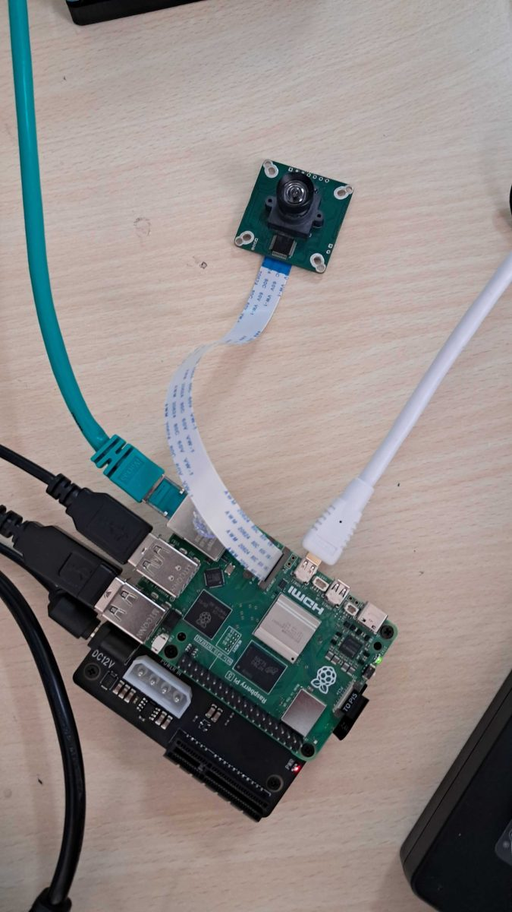

# Hardware setup

This takes a bare Raspberry Pi 5 to the point where every camera shows a picture and the YOLO model
runs. No prior Pi experience is assumed. Work top to bottom.

The reference build uses three USB cameras: Logitech MX Brio 4K (`cam-01`), Arducam AR0234 2.3 MP
global shutter (`cam-02`) and an IMX678 8 MP USB camera (`cam-03`). CSI ribbon cameras are also
supported; see [CSI cameras](#csi-cameras-on-the-pi-5) below.

## Flash the operating system

1. On your laptop, install Raspberry Pi Imager from raspberrypi.com/software.
2. Insert a microSD card (32 GB or more).
3. In Imager pick Device: Raspberry Pi 5, OS: Raspberry Pi OS (64-bit), and your card. It has to be
   64-bit for Ultralytics.
4. Open Edit Settings before writing and set:
   - hostname `watchpost`
   - SSH enabled, with a username and password
   - your Wi-Fi name and password
5. Write the card and eject it.

## First boot

1. Put the card in the Pi. Connect a monitor and keyboard, or work headless over SSH.
2. Power it with the official 27 W USB-C supply. A weaker supply plus cameras causes random
   crashes and throttling.
3. Wait about a minute, then from your laptop:
   ```bash
   ssh <your-username>@watchpost.local
   ```
4. Update once:
   ```bash
   sudo apt update && sudo apt full-upgrade -y
   sudo reboot
   ```

## Plug in USB cameras

The Pi 5 has two USB controllers, and each blue USB 3.0 port sits on its own one. Spread the
bandwidth-heavy cameras across them:

| Camera | Port |
| --- | --- |
| MX Brio 4K (`cam-01`) | blue USB 3.0 port |
| IMX678 8 MP (`cam-03`) | the other blue USB 3.0 port |
| AR0234 2.3 MP (`cam-02`) | a black USB 2.0 port is enough |

## Install the software

```bash
sudo apt install -y git
git clone <this repo> ~/watchpost
cd ~/watchpost
bash edge/deploy/install.sh
```

The script installs `python3-venv`, `python3-picamera2` and `v4l-utils`, creates `edge/.venv` with
`--system-site-packages`, installs `edge/requirements.txt`, copies `edge/.env.example` to
`edge/.env`, exports the NCNN model and installs the `watchpost` systemd unit (enabled, not
started). It also adds your user to the `video` group, so log out and back in once.

The first install pulls PyTorch for Ultralytics and takes several minutes on a Pi.

The manual equivalent, if you prefer:

```bash
sudo apt install -y python3-venv python3-picamera2 v4l-utils
cd ~/watchpost/edge
python3 -m venv --system-site-packages .venv
source .venv/bin/activate
pip install --upgrade pip
pip install -r requirements.txt
cp .env.example .env && chmod 600 .env
```

The rest of this page assumes you are in `~/watchpost/edge` with the venv active.

## Find the USB cameras

```bash
v4l2-ctl --list-devices
```

Typical output:

```text
Logitech MX Brio (usb-xhci-hcd.0):
        /dev/video0
        /dev/video1
Arducam AR0234 (usb-...):
        /dev/video2
        /dev/video3
USB Camera IMX678 (usb-...):
        /dev/video4
        /dev/video5
```

Each camera usually shows two nodes. The lower number is normally the video stream and the other
is metadata. Here that gives `device: 0`, `2` and `4`, which is what `config.yaml` ships with.

The numbers can change between reboots. The paths under `/dev/v4l/by-id/` do not, and `device`
accepts them:

```bash
ls -l /dev/v4l/by-id/
```

To see the formats a camera offers:

```bash
v4l2-ctl -d /dev/video2 --list-formats-ext
```

## CSI cameras on the Pi 5

Ribbon cameras (Camera Module 3, Arducam CSI boards and similar) go through libcamera, which
OpenCV's V4L2 capture cannot read. Watchpost reads them with picamera2 instead.



1. With the Pi off, connect the ribbon to one of the two CAM/DISP connectors. The Pi 5 connectors
   are the narrow 22-pin type, so a camera with a wide 15-pin cable needs a Pi 5 adapter cable.
2. Boot and list the cameras:
   ```bash
   rpicam-hello --list-cameras
   ```
   Each camera is listed with an index (0, 1). If nothing shows up, reseat the cable (contacts
   facing the right way) and check whether your sensor needs a `dtoverlay=` line in
   `/boot/firmware/config.txt`; the camera vendor documents this.
3. Make sure picamera2 is installed from apt. It is not on pip in a form that works here:
   ```bash
   sudo apt install -y python3-picamera2
   ```
4. The venv must be created with `--system-site-packages` so it can import the apt package.
   `install.sh` does this. If you made the venv without it, delete `edge/.venv` and create it
   again. Check with:
   ```bash
   .venv/bin/python -c "import picamera2; print('ok')"
   ```
5. In `config.yaml`, give the camera `backend: picamera2` and set `device` to the index from
   `rpicam-hello`. A commented `cam-04` example is at the end of the file.

USB and CSI cameras can be mixed in one config.

## Test every camera at once

`tools/camera_test.py` opens every camera listed in `config.yaml`, each in its own thread, and
labels each frame with the camera id, device and measured FPS. A camera that fails to open prints
`FAIL` without stopping the others.

With a monitor:

```bash
python tools/camera_test.py
```

One window per camera appears. Press `q` to quit.

Headless over SSH:

```bash
python tools/camera_test.py --save
```

This runs for about two seconds and writes one JPEG per camera to `edge/captures/`. Copy them to
your laptop to look at them:

```bash
# on the laptop
scp '<user>@watchpost.local:~/watchpost/edge/captures/*.jpg' .
```

If a camera does not open:

- Wrong node: check `v4l2-ctl --list-devices` again and try the other `/dev/videoN` of that camera.
- "Device or resource busy": another program holds it. Stop the `watchpost` service if it is
  running (`sudo systemctl stop watchpost`) and close other camera apps.
- Stutter or one camera dropping out: USB bandwidth. Lower `width`, `height` or `fps` for that
  camera in `config.yaml`, or move it to the other USB controller.
- Permission denied: `sudo usermod -aG video $USER`, then log in again.
- CSI camera missing: see the CSI section above.

## Export YOLO26 to NCNN

`install.sh` already tried this. To do it by hand:

```bash
yolo export model=yolo26n.pt format=ncnn imgsz=640
# creates edge/yolo26n_ncnn_model/
```

Sanity check:

```bash
yolo predict model=yolo26n_ncnn_model source='https://ultralytics.com/images/bus.jpg'
```

It should find people and a bus and save an annotated image under `runs/`.

On a Pi 5 the export works. On a Pi 4 it can fail with `Illegal instruction (core dumped)`, because
of the 16K vs 4K kernel page size (`getconf PAGESIZE` shows which you have). In that case export on
a laptop, or in the `ultralytics/ultralytics:latest-arm64` Docker image, and copy the whole
`yolo26n_ncnn_model/` folder into `edge/`.

If YOLO26 misbehaves, the same commands work with `yolo11n.pt` or `yolov8n.pt`. Set `model.path`
in `config.yaml` to the folder it creates.

## Next steps

At this point the Pi is updated, every camera shows a picture in `camera_test.py`, and
`yolo26n_ncnn_model/` exists. Continue with the Supabase and Pi steps in the
[README quick start](../README.md#quick-start), starting with `python -m watchpost --dry-run`.

## Handy commands

```bash
v4l2-ctl --list-devices          # which USB camera is which /dev/videoN
ls -l /dev/v4l/by-id/            # stable USB camera paths
rpicam-hello --list-cameras      # CSI cameras and their indexes
vcgencmd measure_temp            # SoC temperature
vcgencmd get_throttled           # 0x0 means no power or heat throttling
htop                             # CPU and memory (sudo apt install htop)
journalctl -u watchpost -f       # service logs
```
